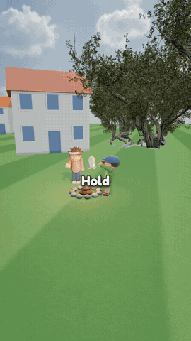
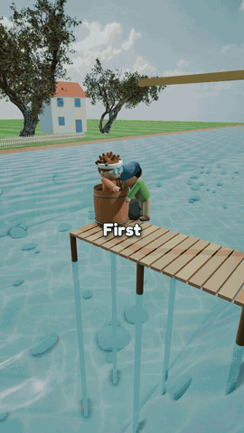
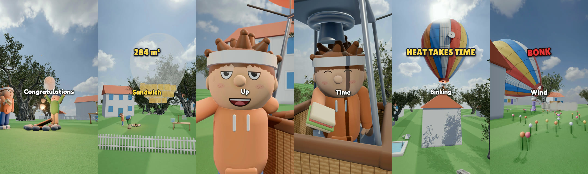
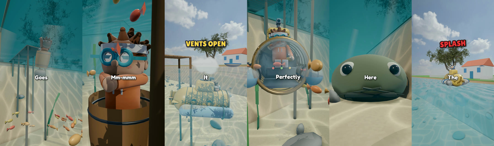

# toyworld-reels

Vertical 3D explainer reels about how everyday machines work, made entirely in code.

Each reel is 60 to 75 seconds at 1080x1920. A toy cast (Ben, the narrator, the neighbour, grandma) on a floating island
tries the silliest version of a machine first, fails, and fixes one real design idea at a time until the thing works:
"Put Ben in a barrel, tie on a rock and push. Congratulations, you've built a submarine!"

Everything is generated: Three.js for the picture, physics computed so every bounce, splash and landing is believable,
painted toy faces with blinks and lip sync, an offline voiceover (Kokoro), captions and labels, a synthesised music bed and
sound effects, mastered to -14 LUFS. The repo ships the kit, a command-line tool, two finished reels as worked examples, and
a Claude Code skill that runs the whole workflow.

<table>
<tr>
<td align="center"><a href="https://github.com/sanskarprajapati/toyworld-reels/releases/download/v0.1.0/balloon-reel.mp4"></a><br><b>How a hot-air balloon works</b><br>59 s · 49 shots · <a href="https://github.com/sanskarprajapati/toyworld-reels/releases/download/v0.1.0/balloon-reel.mp4">watch with sound</a></td>
<td align="center"><a href="https://github.com/sanskarprajapati/toyworld-reels/releases/download/v0.1.0/submarine-reel.mp4"></a><br><b>How a submarine works</b><br>57 s · 45 shots · <a href="https://github.com/sanskarprajapati/toyworld-reels/releases/download/v0.1.0/submarine-reel.mp4">watch with sound</a></td>
</tr>
</table>




## Install

You need macOS or Linux with git, Node 20+, Python 3.11 to 3.13 (or [uv](https://github.com/astral-sh/uv)) and ffmpeg.

```sh
git clone https://github.com/sanskarprajapati/toyworld-reels
cd toyworld-reels
./setup.sh            # about 1 GB: render engine, voice model, 3D assets
./tw doctor
```

`./setup.sh --music` also downloads the CC0 orchestral sample packs (about 800 MB) for the real-instrument music bed.
Without them the same score plays on modelled plucked strings.

### As a Claude Code plugin

```
/plugin marketplace add sanskarprajapati/toyworld-reels
/plugin install toyworld-reels@toyworld-reels
```

Then ask Claude for a reel ("make a toy-world explainer about how a canal lock works"). The skill proposes three topics,
writes the storyboard, builds and reviews the shots, voices them, sends you the first 15 seconds for approval, and then
finishes the reel. On first use it runs `setup.sh` for you.

## Make a reel by hand

```sh
./tw new ~/reels/canal-lock          # copies the starter film (3 shots, a bouncing ball, lip sync, a label)
./tw sheet ~/reels/canal-lock        # contact sheet of every shot -> review/sheet.jpg
./tw voice ~/reels/canal-lock tts    # synthesise the lines, check them with Whisper
./tw voice ~/reels/canal-lock timing # cut every shot to its lines: no dead air
./tw render ~/reels/canal-lock 15    # render the opening only; leave the number off for the full reel
./tw assemble ~/reels/canal-lock ~/reels/canal-lock/render/opening_picture.mp4 ~/reels/canal-lock/output/opening.mp4
./tw check ~/reels/canal-lock ~/reels/canal-lock/output/opening.mp4
```

A film folder holds `STORYBOARD.md`, `durations.json`, `src/` (set, physics, shots), `voice/script.json` and
`audio/events.json`. Read [the workflow](skills/toyworld-reels/references/WORKFLOW.md), [the style rules](skills/toyworld-reels/references/STYLE.md),
[the physics notes](skills/toyworld-reels/references/PHYSICS.md) and [the kit reference](skills/toyworld-reels/references/KIT.md).

## Re-render the examples

The examples include their recorded voice lines, so they reproduce exactly:

```sh
./tw voice examples/submarine timing
./tw render examples/submarine
./tw assemble examples/submarine
```

Rendering takes about 4 seconds per second of film on an Apple Silicon laptop (two browser workers).

## How it is put together

| Part | What it does |
|---|---|
| `kit/` | Three.js library: floating island, houses, trees, sky; toy characters with painted face atlases; acting (idle, blinks, lip sync, gestures); particles; post (AO, depth of field, bloom, grade); staging and camera helpers |
| `tools/voice.py` | Kokoro TTS per line, Whisper check, then fits every shot to its lines and writes captions and lip-sync envelopes |
| `tools/mix.py`, `sfxlib.py`, `music.py` | voice processing, 54 synthesised sound effects placed per shot, the music bed |
| `tools/overlay.py` | word-by-word captions, labels, counters, periscope mask |
| `tw` | the command-line tool |
| `skills/toyworld-reels/` | the Claude Code skill: process, style rules, physics recipes, gotchas |

Rendering, headless capture, TTS, the speech check, sample playback and loudness mastering come from
[Lemo-Opuscar](https://github.com/lemomo-ai/lemo-opuscar) (MIT), which `setup.sh` installs to `~/.toyworld/`.

## License

Code: MIT. The 3D assets are CC0 from [Poly Haven](https://polyhaven.com) and are downloaded at setup, not stored here.
Fonts: SIL Open Font License. See [CREDITS.md](CREDITS.md).
